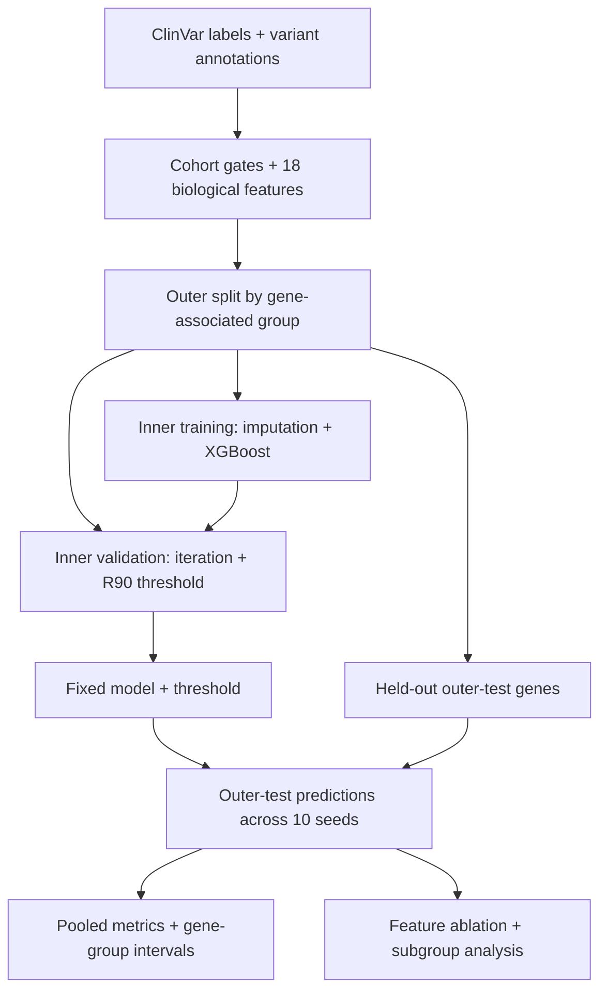

# Hearing-loss variant classification: generalization to unseen genes

[](https://github.com/NingyuSUN/clinvar-hearingloss-ml/actions/workflows/ci.yml)
[](LICENSE)

## Project evidence at a glance

**Authors:** Ningyu Sun (project lead) and Max Cao
([@Max-Cao-0105](https://github.com/Max-Cao-0105)). The project covers research design,
data preparation, model evaluation, statistical review and research software delivery.

- **Study:** 7,125 ClinVar variants across 167 gene groups; gene-held-out AUC
  **0.930 [conditional 95% interval: 0.892, 0.974]**.
- **Delivery:** five frozen inference configurations that combine the 18 features with
  [GPN-Star](#pretrained-genomic-model-scores-gpn-star-and-alphagenome) DNA language-model
  scores and an AlphaGenome-based composite score, with documented input coverage and
  explicit reasons for unavailable scores. Experimental live scoring currently permits
  the GPN-Star-only model (`GPN3`) when its checks pass.
- **Review the evidence:** [methods, actual errors, reproducibility and limits](docs/PROJECT_EVIDENCE.md)
  · [numerical results](results/statistics_20260921/summary.json)
  · [inference contract](docs/predict.md).

**How well does a ClinVar pathogenicity classifier generalize to genes excluded
from training, and which biological features drive its predictions?**

This research project combines ClinVar labels, VEP annotations, gnomAD frequency
and gene constraint, protein domains, and conservation in an XGBoost pipeline.
The prediction tool adds scores from two pretrained genomic models,
[GPN-Star and AlphaGenome](#pretrained-genomic-model-scores-gpn-star-and-alphagenome).
It demonstrates gene-group evaluation, feature ablation, out-of-fold attribution,
and reproducible inference. It is not a clinical diagnostic tool.

## Evaluation workflow



This shows the completed model evaluation and frozen-prediction reanalysis.
The five-model prediction demo below is a separate deliverable; probability calibration and independent external validation
are outside the completed evaluation.

## Main findings

Published results use seed-averaged out-of-fold predictions from grouped
five-fold evaluation over ten seeds.

| Evaluation cohort | Variants | Pooled ROC-AUC [95% interval] |
|---|---:|---:|
| Headline: feature-complete, ClinVar review status ≥1 star | 7,125 | 0.930 [0.892, 0.974] |
| Coding non-truncating subset | 3,121 | 0.815 [0.702, 0.920] |

The headline cohort contains 167 gene groups. A separate random-row-split
comparison reports AUC around 0.996, illustrating how much the evaluation changes
when genes can appear on both sides of the split.

Feature ablations and SHAP highlight consequence type and allele frequency.
At the headline model's validation-selected R90 threshold, outer-test pooled
recall is **0.845**, and coding non-truncating recall is **0.530**.
A validation target of 90% recall does not guarantee that recall on new genes.

**Coding non-truncating is not strict missense.** Historical result filenames
containing `missense` refer to the broader subset. The [statistical revision](docs/statistical_revision.md)
uses 2,000 whole-gene-group bootstrap draws, conditional on fixed predictions;
intervals exclude retraining and full CV dependence. Ablation differences are
descriptive, without independent-fold significance claims.
See [results](docs/results.md) and [validation status](docs/validation_status.md).

## Protein language model extension

A prespecified follow-up ([protocol](docs/plm_protocol.md) ·
[results](docs/plm_results.md)) added zero-shot ESM-1v and ESM-2 650M
masked-marginal scores for 1,328 missense variants. The splits and seeds were
unchanged, and uncertainty comes from a paired gene-group bootstrap.

- **Coding non-truncating subgroup (primary):** AUC rises from 0.823 to 0.988
  (+0.165 [+0.067, +0.273]). A control model that only knows *whether* a
  variant has a score reaches 0.985. Most of the overall gain is reproduced
  by this scored-status control; an additional gain beyond the control is not
  demonstrated. Score availability also separates consequence classes.
- **Within missense variants (secondary):** AUC rises from 0.967 to 0.984
  (+0.017 [+0.005, +0.033]). Training remained mixed, so this historical
  comparison does not isolate the score increment beyond availability.
- **Zero-shot ESM-1v alone on missense:** AUC 0.875, below the 18 features'
  0.967.

### Missense-only training follow-up (2026-10-21)

An [exploratory four-arm experiment](experiments/esm_missense_2x2/README.md)
compares mixed coding non-truncating versus scored-missense-only training,
with and without ESM-1v. All arms are evaluated on the same **1,328 scored
missense records (925 P/LP, 403 B/LB; 135 gene groups)**, and share the same
missense validation target. ESM-1v is frozen; the downstream XGBoost models
are newly fitted.

| Training population | Features | AUC | Missed P/LP / 925 | False-positive B/LB / 403 |
|---|---|---:|---:|---:|
| Mixed coding non-truncating | Original18 | 0.972353 | 80 | 24 |
| Mixed coding non-truncating | Original18 + ESM-1v | 0.984591 | 130 | 9 |
| Scored missense only | Original18 | 0.976574 | 91 | 20 |
| Scored missense only | Original18 + ESM-1v | 0.986222 | 128 | 8 |

After missense-only training, ESM improves AUC by **0.009648** (conditional
95% interval **0.003683 to 0.016476**), while recall falls by **4.0 percentage
points** (interval **−7.887 to −0.812**). There are 37 more false negatives
and 12 fewer false positives under the validation-selected R90/voting rule.
AUC measures ranking; it does not guarantee fewer misses at a selected threshold.
Neither training-scope comparison establishes that missense-only training is
better than mixed training, and neither establishes equivalence.

This follow-up is exploratory: 40/50 inner validation subsets contain only two
missense gene groups. Intervals condition on fixed fitted predictions and omit
retraining and threshold-selection uncertainty. The common missense validation
target differs from the historical analysis above, so the new controls must not
be substituted into its contrasts. No external or clinical validation is claimed.

## Try the frozen prediction demo

From the repository root, using Python 3.11 or later:

```bash
pip install -r predict/requirements-inference.txt
python predict/predict_variants.py --input predict/examples/input.csv --bundle predict/bundle --output demo_output/
python predict/render_variant_report.py --predictions demo_output/predictions.jsonl --variant-id 48
```

Use a fresh output directory. This replays supported variants in the frozen
annotation cache across five bundled model configurations; it does not annotate
arbitrary new variants. Scores are uncalibrated.
Read the [prediction contract](docs/predict.md) for supported inputs and model provenance.

## Pretrained genomic model scores: GPN-Star and AlphaGenome

The headline evaluation above uses the 18 hand-engineered features only. The five
prediction configurations add scores from two pretrained genomic models:

| Configuration | Inputs |
|---|---|
| `ORIGINAL18` | The 18 features (same feature set as the headline model) |
| `GPN3` | Three GPN-Star scores only |
| `ORIGINAL18_GPN` | 18 features + three GPN-Star scores |
| `FULL_UNIFIED` | 18 features + GPN-Star + AVI, one pooled model |
| `FULL_STRATIFIED` | Same inputs, with a protein-track sub-model for missense variants and an RNA-track sub-model for the other supported classes |

- **GPN-Star** ([Song lab, GPN](https://github.com/songlab-cal/gpn)): log-likelihood
  ratio scores from three checkpoints (vertebrate-100, mammal-447 and primate-243).
  Scores are read from the precomputed public dataset
  [`songlab/gpn-star-scores`](https://huggingface.co/datasets/songlab/gpn-star-scores)
  on Hugging Face; no local model or GPU is needed.
- **AlphaGenome** ([Google DeepMind](https://github.com/google-deepmind/alphagenome)):
  enters through **AVI**, a composite variant score that blends AlphaGenome with
  AlphaMissense and related signals, and through splice-site annotations. AVI is not
  a pure AlphaGenome score, and there is no AlphaGenome-only model in this release.
  The [live annotation path](docs/predict_novel.md) can request AVI and splice-site
  annotations with your own key (`pip install alphagenome`, `ALPHAGENOME_API_KEY`);
  without a key they remain missing.

These configurations use gene-group folds under a fixed research profile. Their
scores are uncalibrated, and this repository does not report a separate performance
estimate for them: the headline AUC above applies to the 18-feature model.

## Evaluation and reproduction

Gene co-occurrence defines the split groups. Inner training data determine
imputation; an inner gene-group holdout selects model iteration and threshold.
Outer-test genes are excluded from these choices.

```bash
conda env create -f environment.yml
conda activate hearingloss-variants
pip install -e .
python scripts/run_evaluation.py --out runs/readme_reproduction
python scripts/analyze_results.py --dir runs/readme_reproduction
```

This trains models from the committed modelling matrix and can take time.
Use a new output directory to preserve published results.
[Methods](docs/methods.md) explain the protocol; [data](docs/data.md) explains
the matrix and the `HLPATH_DATA` override.

## Scope and next steps

VUS/conflicting labels are excluded; frequency partly overlaps the evidence used
to assign ClinVar labels. Conservation provenance remains unresolved. The
[live annotation path](docs/predict_novel.md) blocks models that require the unresolved conservation feature
and has no independent external validation; the frozen demo is the review entrypoint.

Probability calibration and independent external validation remain research
boundaries. The completed missense follow-up and remaining threshold-robustness
work are indexed in [project status](PROJECT_STATUS.md).
[Engineering case study](docs/engineering_case_study.md) · [Model card](MODEL_CARD.md) · [Limitations](docs/limitations.md) ·
[SHAP analysis](docs/shap.md) · [CI checks](.github/workflows/ci.yml)

